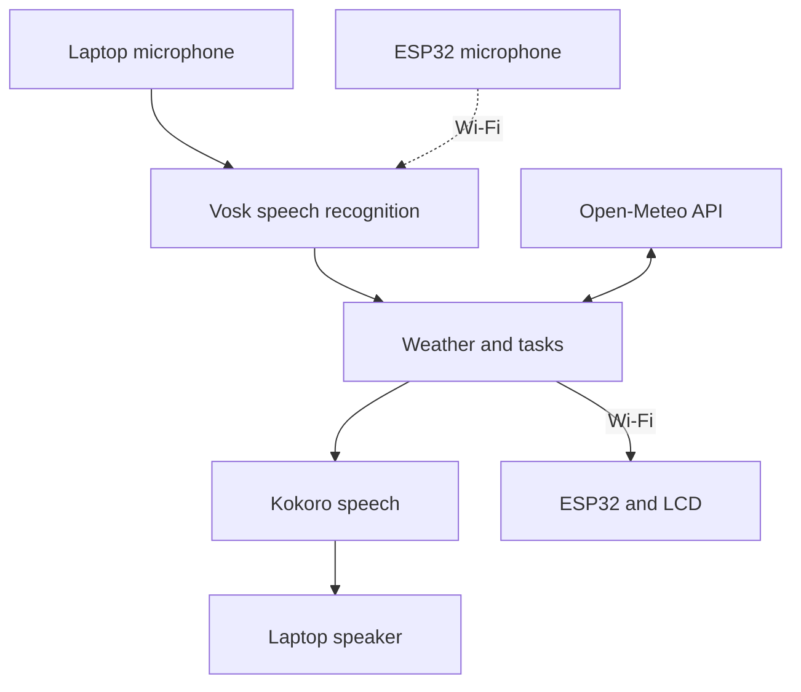
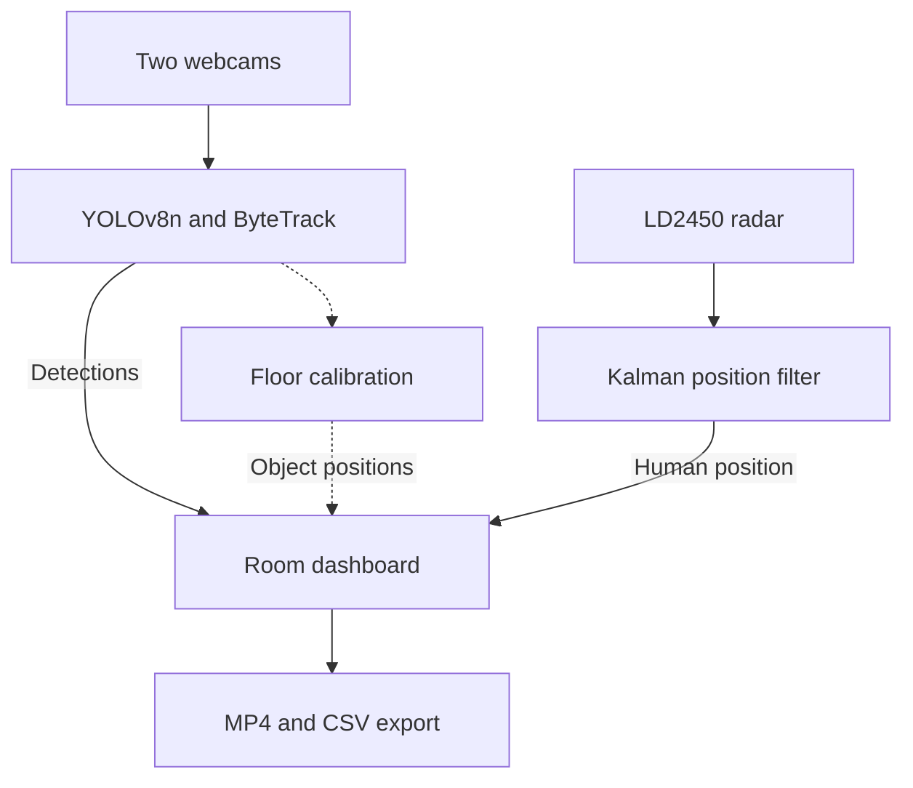

# Kogane firmware

The STM32 handles flight control. The ESP32 handles peripherals and Wi-Fi. The laptop runs voice recognition, speech and room mapping.

Demo plans, feature runbooks and the shipping checklist are collected in [Demo/INDEX.md](Demo/INDEX.md).

| Directory | Purpose | Tested toolchain |
| --- | --- | --- |
| [fc-inav](fc-inav/) | Custom STM32F722 iNAV image, patches and configuration references | iNAV 9.1.0 / Configurator 9.1.1 |
| [companion-esp32s3](companion-esp32s3/) | ESP32-S3 LCD, microphone, servo and FC telemetry | ESP-IDF 6.1 |
| [base-station](base-station/) | Voice assistant, weather, tasks and camera/radar dashboard | Python 3.13 was tested. Python 3.11+ is required. |
| [shared](shared/PROTOCOL.md) | KGN UDP message definitions | Shared by companion and laptop |
| [mmwave-node-esp32c3](mmwave-node-esp32c3/) | Earlier optional Wi-Fi radar-node implementation | Not used by the current USB-UART radar demo |

## System pipeline

### Voice assistant



### Room mapping



### Flight control and telemetry


## STM32 flight controller

1. Back up `diff all` in iNAV CLI.
2. Disconnect the battery and enter STM32 DFU: hold SW2/BOOT while resetting or connecting USB.
3. In Configurator, choose **Load Firmware [Local]** and flash [the custom HEX](fc-inav/inav_9.1.0_MATEKF722_uart3-pb10-pb11.hex). Preserve settings for an update of the same target and version. Reconfigure after a reset.
4. Verify `resource` reports UART3 on **PB10 TX / PB11 RX**, motors on PA0–PA3, and healthy gyro/accelerometer in `status`.
5. Configure UART3 Serial RX, receiver **SERIAL / CRSF**, and verify the radio channels. The tested outputs use **DSHOT300** and `PWM_OUTPUT_ENABLE`. Check actual geometry, orientation, motor order/direction, arm/disarm and radio-loss failsafe before flight.

This PCB needs a custom 25 MHz build. The stock MATEKF722 image and reference CLI diff are not substitutes for the tested setup. See [FC instructions](fc-inav/README.md) and [flight checks](Demo/FIRST_FLIGHT_PLAN.md).

Optional onboard ToF: set `rangefinder_hardware = VL53L1X`, save and verify `RANGEFINDER=OK` plus changing readings in Sensors. This does not automatically configure altitude hold.

## ESP32 companion

In an **ESP-IDF 6.1 Command Prompt**, from `firmware/companion-esp32s3`:

```bat
idf.py set-target esp32s3
idf.py menuconfig
idf.py build
idf.py -p COM13 flash
idf.py -p COM13 monitor
```

Run `set-target` only for initial setup. Keep the N16R8 flash settings, custom partition table and native USB Serial/JTAG console. Exit the monitor with **Ctrl+]** before reflashing.

- First boot: leave all **Kogane Companion → Staged hardware bring-up** switches off.
- Then enable Wi-Fi, outbound telemetry, LCD and microphone **one stage at a time**. Keep camera, speaker TX and servo boot sweep off for the normal demo.
- Set `KGN_WIFI_SSID`, `KGN_WIFI_PASS` and `KGN_BASE_IP` locally. Use the laptop's LAN IPv4 from `ipconfig`, reachable 2.4 GHz Wi-Fi and UDP/5005. Credentials stay in ignored `sdkconfig`.
- The defaults disable automatic pre-flash reset. Enter download mode manually if needed: **IO0 low during reset**. Normal application boot needs IO0 high. The working board's IO0 strap was repaired manually. Correct the circuit in the next [PCB revision](../pcb/README.md).
- The LCD, servo and receiver need the battery-backed 5 V rail. A board with a suspected short must be repaired before powering it.

For optional FC telemetry, select `KGN_PINS_OWNER_FC_LINK`, enable `KGN_BRINGUP_FC_LINK` and retain `KGN_FC_RX_ONLY=y`. Set iNAV UART1 to MAVLink at 115200, MSP off on that UART. ESP32 RX=GPIO43 and TX=GPIO44. Keep the request test off during normal use. See [FC link checks](companion-esp32s3/FC_LINK_CHECK.md) and [pin map](companion-esp32s3/PINMAP.md).

## Laptop assistant and mapping

From `firmware/base-station`, in PowerShell:

```powershell
py -3.13 -m venv .venv
.\.venv\Scripts\python.exe -m pip install -e ".[demo,vision,screen,radar,character-voice,dev]"
.\.venv\Scripts\python.exe -m kogane_base.tools.setup_kokoro_voice
```

Reuse an existing working environment. Extract **vosk-model-small-en-us-0.15** from the [Vosk model list](https://alphacephei.com/vosk/models) into `base-station/models/`. Kokoro setup downloads the Natural voice. Use `--speech-style normal` for Windows speech instead.

```powershell
# Check telemetry with other UDP/5005 listeners stopped.
.\.venv\Scripts\python.exe verify_wifi.py listen --seconds 10

# Discover the laptop microphone index, then run one assistant instance.
.\.venv\Scripts\python.exe -m kogane_base.tools.demo_assistant --list-mics
.\.venv\Scripts\python.exe -m kogane_base.tools.demo_assistant --device 3 --host 10.0.0.47
```

Replace device **3** and **10.0.0.47** with the actual microphone and ESP32 address. Omit `--host` for laptop preview only. Say **Kogane**, wait for **Listening**, then ask **Show me the weather today**, **Show me my tasks for today**, or **New task buy groceries**. Weather needs internet. Recognition, speech and tasks run locally. Press **Q** to exit.

- [Tasks](Demo/TASKS_DEMO.md), [weather](Demo/WEATHER_DEMO.md), [voice/LCD and wake tuning](Demo/VOICE_LCD_DEMO.md), [voice styles](Demo/VOICE_STYLE.md).
- [Stationary onboard microphone](Demo/BOARD_MIC_TEST.md): optional board audio over Wi-Fi. Recognition runs on the laptop. In-flight noise performance is unverified.
- [Room mapping](Demo/ROOM_MAPPING_DEMO.md): two webcams for coverage and an LD2450 via USB-UART for human positions. No ESP32-C3 or stereo calibration is required for this mode. [Object mapping](Demo/OBJECT_MAPPING.md) needs floor calibration for approximate furniture positions.

Models, credentials, calibration, tasks and recordings are local files excluded from Git. A fresh clone needs its own setup. The verified snapshot passed 741 Python tests and the FC-link C/build checks.
