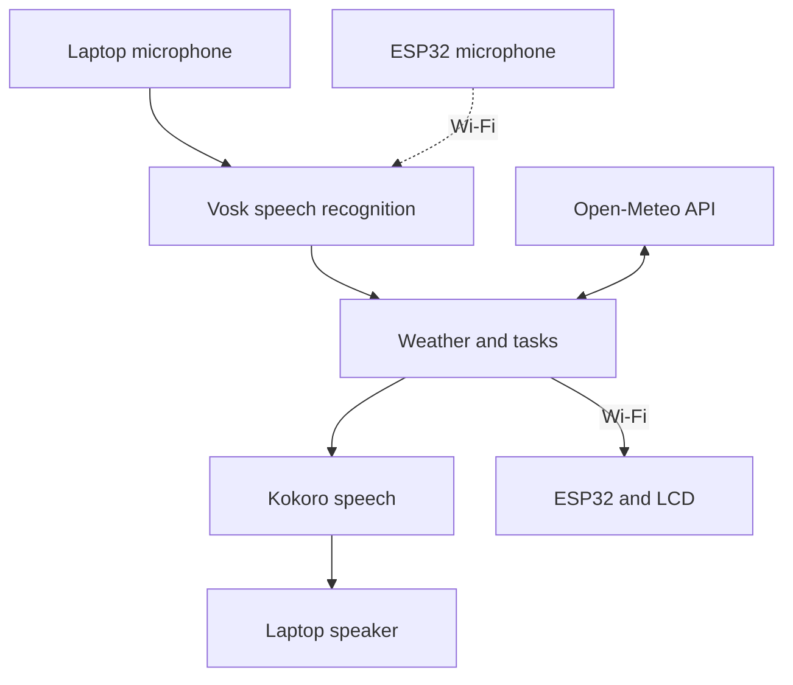
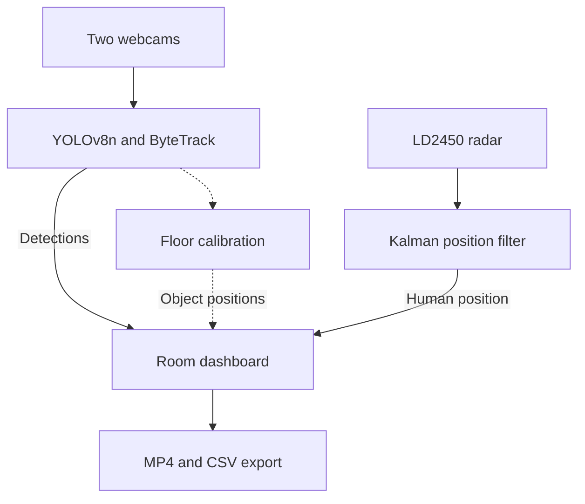
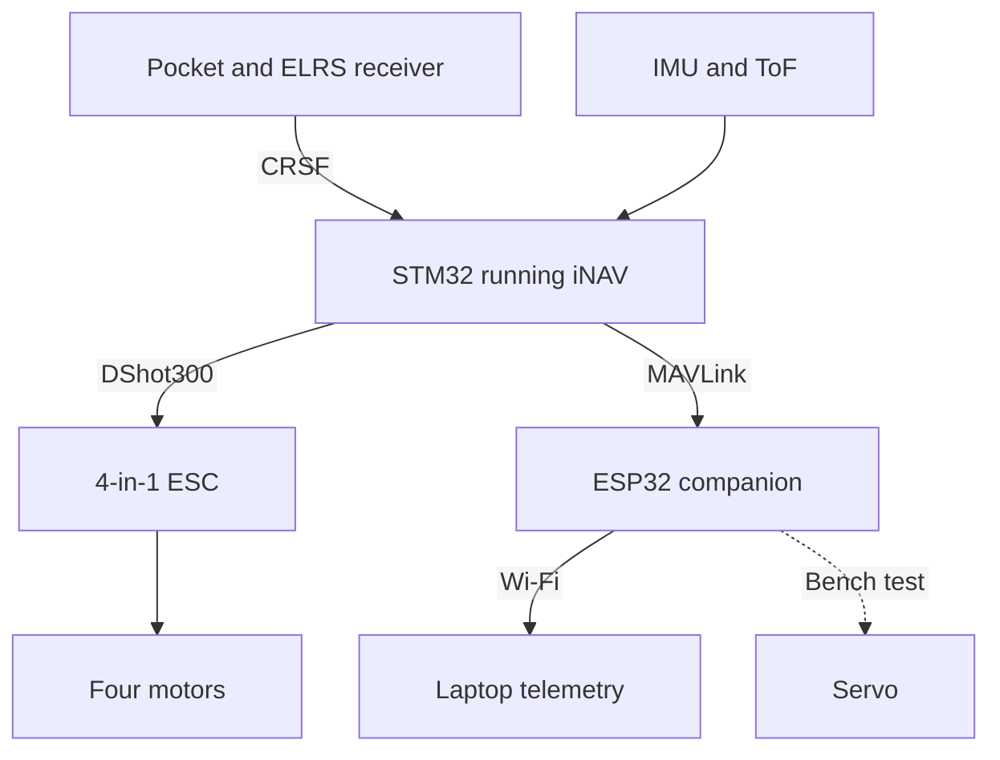

# Kogane firmware

The STM32 runs flight control; the ESP32 handles Wi-Fi and payloads; the laptop runs voice and room mapping. Manual flight uses ELRS radio control. Autonomous following and voice flight commands are not enabled in the demonstrated setup.

Demo plans, feature runbooks and the shipping checklist are collected in [Demo/INDEX.md](Demo/INDEX.md).

| Directory | Purpose | Tested toolchain |
| --- | --- | --- |
| [fc-inav](fc-inav/) | Custom STM32F722 iNAV image, patches and configuration references | iNAV 9.1.0 / Configurator 9.1.1 |
| [companion-esp32s3](companion-esp32s3/) | ESP32-S3 LCD, microphone, servo and FC telemetry | ESP-IDF 6.1 |
| [base-station](base-station/) | Voice assistant, weather, tasks and camera/radar dashboard | Python 3.13; project requires 3.11+ |
| [shared](shared/PROTOCOL.md) | KGN UDP message definitions | Shared by companion and laptop |
| [mmwave-node-esp32c3](mmwave-node-esp32c3/) | Earlier optional Wi-Fi radar-node implementation | Not used by the current USB-UART radar demo |

## System pipeline

Voice and mapping run on the laptop. The radio controls flight. Edit the Mermaid blocks below to change the diagrams; dashed lines mark optional paths.

### Voice assistant



Vosk handles the wake word and commands. Tasks are stored locally; weather is fetched online.

### Room mapping



Radar supplies human positions. The cameras detect people and furniture; placing furniture on the map requires floor calibration.

### Flight control and telemetry



The ESP32 receives flight-controller telemetry; flight commands remain blocked. Autonomous following, onboard camera output and screen retraction are future work. The onboard speaker needs a hardware repair.

Remove propellers for flashing and bench checks. USB ports, camera indices and IP addresses below are examples; use the devices actually connected. The physical prototypes include repairs not reflected in the saved PCB.

## STM32 flight controller

1. Back up `diff all` in iNAV CLI.
2. Disconnect the battery and enter STM32 DFU: hold SW2/BOOT while resetting or connecting USB.
3. In Configurator, choose **Load Firmware [Local]** and flash [the custom HEX](fc-inav/inav_9.1.0_MATEKF722_uart3-pb10-pb11.hex). Preserve settings for a same-target/version update; a reset requires complete reconfiguration.
4. Verify `resource` reports UART3 on **PB10 TX / PB11 RX**, motors on PA0–PA3, and healthy gyro/accelerometer in `status`.
5. Configure UART3 Serial RX, receiver **SERIAL / CRSF**, and verify the radio channels. The tested outputs use **DSHOT300** and `PWM_OUTPUT_ENABLE`. Check actual geometry, orientation, motor order/direction, arm/disarm and radio-loss failsafe before flight.

This PCB has a **25 MHz crystal** and custom peripheral/timer assignments. Do not substitute an online stock MATEKF722 image or paste `config/kogane-fc.diff` as a restore script. `target/KOGANEF722` is unfinished. See [FC setup](fc-inav/README.md) and [flight checks](Demo/FIRST_FLIGHT_PLAN.md).

Optional onboard ToF: set `rangefinder_hardware = VL53L1X`, save and verify `RANGEFINDER=OK` plus changing readings in Sensors. This does not automatically configure altitude hold.

## ESP32 companion

In an **ESP-IDF 6.1 Command Prompt**, from `firmware/companion-esp32s3`:

```bat
idf.py set-target esp32s3
idf.py menuconfig
idf.py build
idf.py -p COM13 flash
idf.py -p COM13 monitor
```

Run `set-target` only for initial setup. The N16R8 module uses 16 MB flash and octal PSRAM; keep the custom partition table and native USB Serial/JTAG console. Exit the monitor with **Ctrl+]** before reflashing.

- First boot: leave all **Kogane Companion → Staged hardware bring-up** switches off.
- Then enable Wi-Fi, outbound telemetry, LCD and microphone **one stage at a time**. Keep camera, speaker TX and servo boot sweep off for the normal demo.
- Set `KGN_WIFI_SSID`, `KGN_WIFI_PASS` and `KGN_BASE_IP` locally. The base IP is the laptop's LAN IPv4 from `ipconfig`; use reachable 2.4 GHz Wi-Fi and UDP/5005. Credentials stay in ignored `sdkconfig`.
- The defaults disable automatic pre-flash reset. Enter download mode manually if needed: **IO0 low during reset**. Normal application boot needs IO0 high. The working board's reversed IO0 strap was repaired; historical instructions to hold SW3 to run the app are obsolete for that repaired board.
- The LCD, servo and receiver need the battery-backed 5 V rail. A board with a suspected short must be repaired before powering it.

For optional FC telemetry, select `KGN_PINS_OWNER_FC_LINK`, enable `KGN_BRINGUP_FC_LINK` and retain `KGN_FC_RX_ONLY=y`. Set iNAV UART1 to MAVLink at 115200, MSP off on that UART. ESP32 RX=GPIO43 and TX=GPIO44. Keep the request test off during normal use. See [FC link checks](companion-esp32s3/FC_LINK_CHECK.md) and [pin map](companion-esp32s3/PINMAP.md).

## Laptop assistant and mapping

From `firmware/base-station`, in PowerShell:

```powershell
py -3.13 -m venv .venv
.\.venv\Scripts\python.exe -m pip install -e ".[demo,vision,screen,radar,character-voice,dev]"
.\.venv\Scripts\python.exe -m kogane_base.tools.setup_kokoro_voice
```

Skip virtual-environment creation when reusing a working environment. Download **vosk-model-small-en-us-0.15** from the [official model list](https://alphacephei.com/vosk/models) and extract it to `base-station/models/vosk-model-small-en-us-0.15/`. Kokoro setup downloads/verifies the default Natural voice separately. Use `--speech-style normal` for Windows speech if the neural model is unavailable.

```powershell
# Check telemetry with other UDP/5005 listeners stopped.
.\.venv\Scripts\python.exe verify_wifi.py listen --seconds 10

# Discover the laptop microphone index, then run one assistant instance.
.\.venv\Scripts\python.exe -m kogane_base.tools.demo_assistant --list-mics
.\.venv\Scripts\python.exe -m kogane_base.tools.demo_assistant --device 3 --host 10.0.0.47
```

Replace device **3** and **10.0.0.47** with the actual microphone and ESP32 address. Omit `--host` for laptop preview only. Say **Kogane**, wait for **Listening**, then ask **Show me the weather today**, **Show me my tasks for today**, or **New task buy groceries**. Weather needs internet; recognition, speech and tasks run locally. Press **Q** to exit.

- [Tasks](Demo/TASKS_DEMO.md), [weather](Demo/WEATHER_DEMO.md), [voice/LCD and wake tuning](Demo/VOICE_LCD_DEMO.md), [voice styles](Demo/VOICE_STYLE.md).
- [Stationary onboard microphone](Demo/BOARD_MIC_TEST.md): optional board audio over Wi-Fi; recognition still runs on the laptop. In-flight noise performance is unverified.
- [Room mapping](Demo/ROOM_MAPPING_DEMO.md): two webcams for coverage and an LD2450 via USB-UART for human positions. No ESP32-C3 or stereo calibration is required for this mode. [Object mapping](Demo/OBJECT_MAPPING.md) needs floor calibration for approximate furniture positions.

Models, credentials, calibration, tasks and recordings are local files excluded from Git. A fresh clone needs its own setup. The snapshot passed 741 Python tests and the FC-link C/build checks; first flight and autonomous navigation are not established by those tests.

## Known PCB issues / next revision

| Issue | Required change |
| --- | --- |
| IO0 pulled down; EN lacks a dedicated pull-up | Proper boot pull-up/button-to-GND and a defined enable/reset circuit. Physical prototype has hand repairs. |
| ESP32 native USB missing | Route GPIO19/20 to a protected, labelled connector instead of module-pad bodge wires. |
| MAX98357A `SD_MODE` grounded | Correct enable/channel-selection wiring; current speaker path is disabled. |
| Battery ADC PC0 unconnected | Add a scaled, filtered divider and test point. Current displayed pack voltage/cell count is invalid. |
| F1 specified for 16 V; Q2 gate stress can exceed its ±8 V rating | Redesign/verify the power path for maximum pack voltage, transients and USB/battery switching. Existing protection is present but needs rating review. |
| Connector mismatch, shared peripheral reset and no LCD readback | Match actual cable parts, add independent reset/readback where needed and improve test access/strain relief. |
| Stale GPIO labels and stock-target assumptions | Keep schematic labels, firmware pins, 25 MHz clock and motor timer/DMA assignments consistent. |

One repaired board has a **suspected VSYS short**, with no failed component isolated; this is separate from the confirmed design issues. See [PCB notes](../pcb/README.md), [power review](fc-inav/POWER_REVIEW.md) and [battery sensing](fc-inav/BATTERY_SENSE_CHECK.md). Reconcile the BOM and rerun ERC/DRC before ordering a revision.
